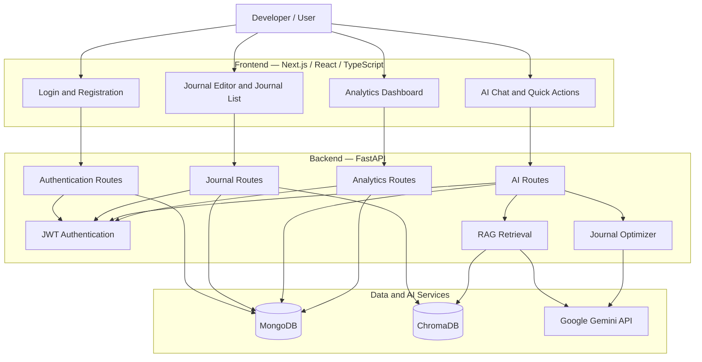
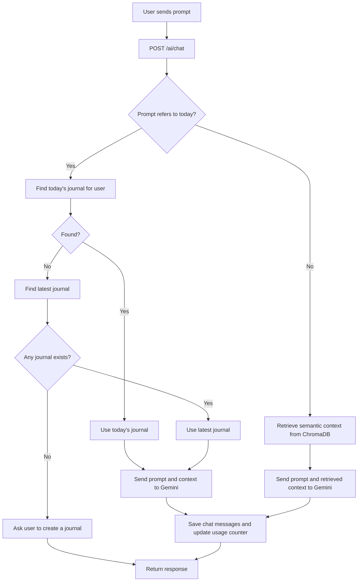
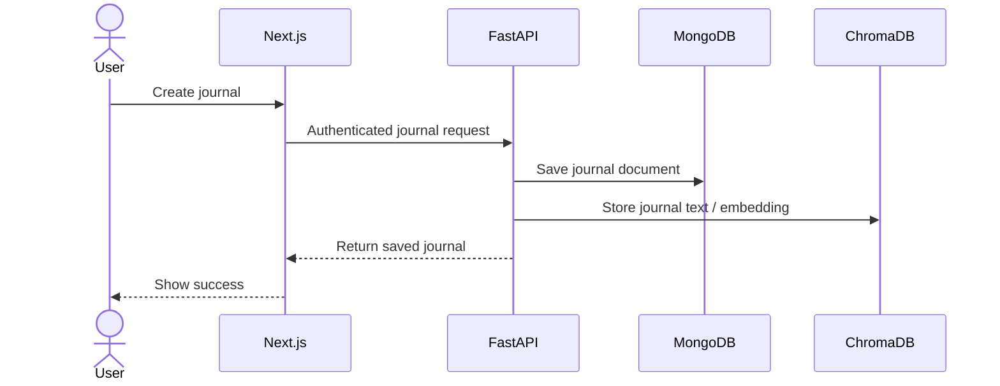

# DevLog AI --- AI-Powered Developer Journal

[](https://www.python.org/)
[](https://fastapi.tiangolo.com/)
[](https://nextjs.org/)
[](https://www.typescriptlang.org/)
[](https://www.mongodb.com/)
[](https://www.trychroma.com/)

DevLog AI is an AI-powered journaling application for developers and
engineers. It helps users record daily work, optimize journal entries
with generative AI, ask questions about their work, and review activity
through analytics. Retrieval-Augmented Generation (RAG) provides
relevant journal context for AI responses. Prompts referring to "today"
can use today's journal or fall back to the user's latest entry.

------------------------------------------------------------------------

## Architecture

The application is organized into three layers:

1.  **Frontend**: Next.js, React, and TypeScript interface for
    authentication, journals, AI chat, Quick Actions, and analytics.
2.  **Backend**: FastAPI service for authentication, journal management,
    AI chat, optimization, and analytics.
3.  **Data and AI services**: MongoDB stores application data; ChromaDB
    supports semantic journal retrieval; Google Gemini generates AI
    responses.

### High-Level Architecture



### AI Chat and Journal Context Flow



### Journal Creation and RAG Indexing



### Technology Stack

  -----------------------------------------------------------------------
  Layer                   Technology              Purpose
  ----------------------- ----------------------- -----------------------
  Frontend                Next.js, React,         User interface
                          TypeScript              

  Backend                 Python, FastAPI,        REST API
                          Uvicorn                 

  Authentication          JWT and password        Protected access
                          hashing                 

  Primary database        MongoDB / PyMongo       Users, journals, chat
                                                  history, counters

  Vector database         ChromaDB                Semantic retrieval of
                                                  journal context

  Generative AI           Google Gemini API       Chat and journal
                                                  optimization

  Rate limiting           SlowAPI                 Limit selected AI
                                                  endpoints

  Deployment              Vercel and Render       Frontend and backend
                                                  hosting
  -----------------------------------------------------------------------

------------------------------------------------------------------------

## Core Features

### Journal Management

-   Create and manage developer journal entries.
-   Retrieve journal entries for history and calendar views.
-   Scope journal records to the authenticated user.
-   Use journal content as context for AI features.

### AI Journal Optimization

-   Submit journal content to the optimization endpoint.
-   Use relevant retrieved context where available.
-   Return an optimized journal entry.
-   Track AI usage through the `ai_optimizations` user field, according
    to the endpoints configured to increment it.

### AI Chat and Quick Actions

-   Submit prompts through `/ai/chat`.
-   Use ChromaDB semantic retrieval for ordinary questions.
-   When the prompt refers to "today", select today's journal or fall
    back to the user's latest journal.
-   Return a helpful message when no journal exists.
-   Store user and AI messages in chat history.
-   Apply rate limits to selected AI endpoints.

### Analytics Dashboard

-   Total journal count.
-   Current consecutive-day journaling streak.
-   Longest historical streak.
-   Monthly journal activity.
-   Calendar and heatmap views.
-   AI usage counter.

**Streak rules:** The current streak remains active if the latest
journal is today or yesterday, and becomes zero if the latest journal is
older than yesterday. The longest streak is calculated from all
available journal dates. The current analytics implementation uses
`Asia/Kolkata` for date-based calculations.

------------------------------------------------------------------------

## Repository Structure

The following is a representative structure based on the modules
referenced in the project. Adjust directory names to match the actual
repository.

``` text
.
├── frontend/                       # Next.js / React / TypeScript
│   └── src/
│       ├── app/                    # Pages and routing
│       │   ├── dashboard/
│       │   └── analytics/
│       ├── components/             # Journal, chat, navigation, UI
│       └── services/               # Frontend API services
│
├── backend/                        # FastAPI application
│   └── app/
│       ├── ai/
│       │   ├── chat.py             # Gemini chat integration
│       │   ├── optimizer.py        # Journal optimization
│       │   └── rag.py              # ChromaDB retrieval
│       ├── database/
│       │   ├── mongodb.py          # MongoDB connection
│       │   └── dependencies.py     # Database dependency
│       ├── middleware/
│       │   ├── auth_middleware.py  # JWT authentication
│       │   └── rate_limit.py       # Rate limiting
│       ├── routes/
│       │   ├── auth.py
│       │   ├── journal.py
│       │   ├── analytics.py
│       │   └── ai.py
│       └── schemas/                # Request/response schemas
│
└── README.md
```

------------------------------------------------------------------------

## Local Development Setup

### Prerequisites

-   Python 3.10+ (use a version supported by the dependencies).
-   Node.js and npm compatible with the Next.js version.
-   MongoDB Atlas or another reachable MongoDB deployment.
-   Google Gemini API key.
-   Backend dependencies required for ChromaDB.

### 1. Backend Setup

Run from the backend directory:

``` bash
python -m venv venv

# Windows PowerShell
.\venv\Scripts\Activate.ps1

# Linux / macOS
source venv/bin/activate

pip install -r requirements.txt
```

Create a `.env` file using the exact variable names read by your
configuration modules. Typical settings may include:

``` env
MONGODB_URI=your_mongodb_connection_string
GEMINI_API_KEY=your_gemini_api_key
SECRET_KEY=replace_with_a_long_random_secret
ALGORITHM=HS256
```

Check `app/database/mongodb.py`, your JWT service, and Gemini
integration for the required names. Never commit real credentials or
`.env`.

If the FastAPI instance is `app.main:app`, start the development server
with:

``` bash
uvicorn app.main:app --reload
```

API base URL: `http://127.0.0.1:8000`\
Interactive API documentation: `http://127.0.0.1:8000/docs`

### 2. Frontend Setup

Run from the frontend directory:

``` bash
npm install
```

Configure the API base URL using the variable expected by your frontend
service. For example:

``` env
NEXT_PUBLIC_API_URL=http://127.0.0.1:8000
```

Then start Next.js:

``` bash
npm run dev
```

The development frontend is typically available at
`http://localhost:3000`.

### 3. Deployment

The project has been deployed using Vercel for the frontend and Render
for the backend.

-   Configure frontend environment variables in Vercel.
-   Configure MongoDB, Gemini, and JWT secrets in Render.
-   Add the exact deployed frontend origin to FastAPI CORS
    configuration.
-   Use HTTPS in production.
-   Avoid wildcard CORS origins when credentials are enabled.
-   Redeploy after changing environment variables or backend
    configuration.

------------------------------------------------------------------------

## API Reference

These routes reflect the route prefixes and handlers referenced in the
project. Confirm exact paths in FastAPI `/docs`.

### Authentication

  Method   Endpoint           Description
  -------- ------------------ -----------------------------------------
  `POST`   `/auth/register`   Register a user
  `POST`   `/auth/login`      Authenticate and obtain a token
  `GET`    `/auth/`           Route health/check endpoint, if enabled

### Journals

  --------------------------------------------------------------------------
  Method                  Endpoint                   Description
  ----------------------- -------------------------- -----------------------
  `GET`                   `/journals/`               Retrieve journal
                                                     entries, depending on
                                                     implementation

  `POST`                  `/journals/`               Create a journal entry,
                                                     depending on
                                                     implementation

  `GET`                   `/journals/{journal_id}`   Retrieve a journal by
                                                     ID, if implemented

  `PUT/PATCH`             `/journals/{journal_id}`   Update a journal, if
                                                     implemented

  `DELETE`                `/journals/{journal_id}`   Delete a journal, if
                                                     implemented
  --------------------------------------------------------------------------

### AI

  ------------------------------------------------------------------------
  Method                  Endpoint                 Description
  ----------------------- ------------------------ -----------------------
  `GET`                   `/ai/`                   AI route health/check
                                                   endpoint

  `GET`                   `/ai/search?query=...`   Retrieve semantically
                                                   relevant context

  `POST`                  `/ai/optimize`           Optimize supplied
                                                   journal content

  `POST`                  `/ai/chat`               Submit an AI chat
                                                   prompt

  `GET`                   `/ai/chat/history`       Retrieve the current
                                                   user's chat history

  `DELETE`                `/ai/chat/history`       Clear the current
                                                   user's chat history
  ------------------------------------------------------------------------

### Analytics

  -------------------------------------------------------------------------------------------------
  Method                  Endpoint                                          Description
  ----------------------- ------------------------------------------------- -----------------------
  `GET`                   `/analytics/`                                     Analytics route
                                                                            health/check endpoint

  `GET`                   `/analytics/month?month={month}&year={year}`      Retrieve journals for a
                                                                            month

  `GET`                   `/analytics/calendar?month={month}&year={year}`   Journal activity days
                                                                            for a month

  `GET`                   `/analytics/total`                                Total journal count

  `GET`                   `/analytics/monthly-count`                        Journal counts grouped
                                                                            by month

  `GET`                   `/analytics/streak`                               Current streak

  `GET`                   `/analytics/longest-streak`                       Longest streak

  `GET`                   `/analytics/heatmap`                              Journal activity counts
                                                                            by date

  `GET`                   `/analytics/activity-calendar`                    Journal and login
                                                                            activity dates

  `GET`                   `/analytics/dashboard`                            Combined dashboard
                                                                            statistics
  -------------------------------------------------------------------------------------------------

------------------------------------------------------------------------

## Security and Data Handling

-   **Authentication:** Protected endpoints use JWT authentication. Send
    `Authorization: Bearer <token>` when required.
-   **User isolation:** Filter journal and chat queries by the
    authenticated user's ID.
-   **Secrets:** Keep database credentials, Gemini API keys, and JWT
    secrets in environment variables.
-   **CORS:** Allow only trusted frontend origins.
-   **Rate limiting:** SlowAPI limits selected AI endpoints.
-   **Validation:** Use Pydantic schemas to validate API payloads.
-   **Chat history:** Clearing chat history removes messages belonging
    to the authenticated user.

------------------------------------------------------------------------

## Troubleshooting

### Login or API requests fail with CORS errors

-   Verify the frontend origin matches the FastAPI CORS allowlist
    exactly.
-   Inspect the `OPTIONS` preflight and actual request in browser
    DevTools.
-   Confirm the frontend API base URL points to the correct backend.

### AI responses use the wrong journal

-   Confirm journal documents have a valid `created_at` timestamp.
-   Verify the authenticated user ID matches the journal's `user_id`.
-   Prompts referring to "today" should use date-based selection;
    ordinary prompts use semantic retrieval.
-   Confirm the journal content field is named `content`.

### Analytics values do not update

-   Refresh Analytics and inspect the API response.
-   Confirm frontend field names match the backend response.
-   Verify the counter update targets the correct MongoDB user document.
-   Ensure timestamp handling is consistent between UTC and IST.

### AI rate limit is reached

Selected AI endpoints are rate-limited. Wait before retrying or adjust
the configured limits for your use case.

------------------------------------------------------------------------

## License

Add the license that applies to this repository before publishing or
distributing the project.
